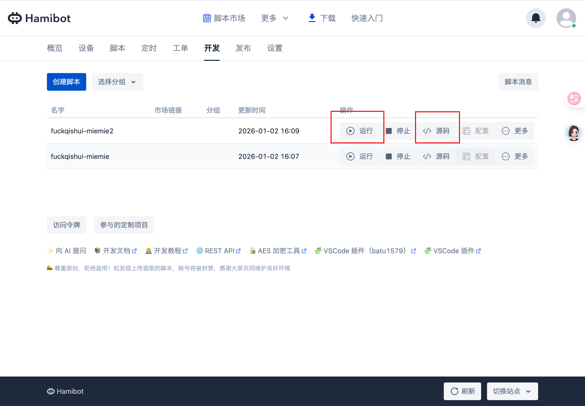
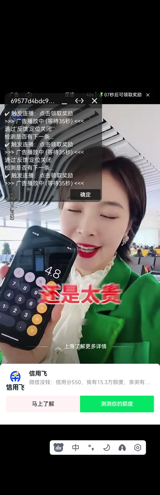

# 汽水音乐任务自动化脚本

这是一个基于 Hamibot / Auto.js 的 Android 自动化脚本，用来验证移动端 App 任务流程的自动化能力。脚本以汽水音乐的「福利」中心任务入口为示例，自动完成进入福利中心、开屏广告跳过、等待广告、关闭广告、领取奖励和状态恢复等步骤。

项目重点是把一个真实 App 中经常变化的任务流程拆成可执行的自动化逻辑：通过底层通用触点接口（TouchCore & Touchpoints）解耦业务逻辑与点击操作，通过包名安全锁保障环境安全，通过状态确认触点（Verify）实现闭环校验，通过相对坐标处理广告页关闭，通过状态判断处理连续奖励、退出确认和任务完成。

## 分支说明

本项目采用以下分支策略，方便管理和使用：

| 分支 | 说明 |
|------|------|
| `master` | 最新版本的稳定版，始终代表当前最可靠的代码。 |
| `dev` | 开发分支，新功能和修复先在此分支验证，稳定后再合并到 `master`。 |
| `master-x.x.x` 等版本分支 | 仅按汽水音乐版本区分的稳定版脚本，如 `master-21.7.0` 分支仅适配汽水音乐 21.7.0 版本。**`master` 后紧跟版本号（无设备型号）表示作者主力机（华为 Mate40）的适配正式版。** |
| `master-设备型号-x.x.x` | 按**设备型号 + 汽水音乐版本**区分的稳定版脚本。例如 `master-honor-Magic-Vs3-19.5.0` 表示：正式版 (`master`) + 荣耀 Magic Vs3 (`honor-Magic-Vs3`) + 汽水音乐 19.5.0 (`19.5.0`)。该分支仅适配此特定设备与版本组合，其他设备或版本可能需自行校准坐标。 |

建议根据你安装的汽水音乐版本（以及设备型号）选择对应分支；如果不确定，优先使用 `master` 分支。

## 功能特性

- 自动等待 Hamibot 无障碍服务启动；
- 采用官方绝对包名（`com.luna.music`）启动 App，内置「包名安全锁」防止误操作；
- 设立 10 秒开屏广告检测窗口，智能识别「跳过」控件与右上角触点加速跳过；
- 识别底部导航栏「福利」Tab 并进入福利中心；
- 内置「状态确认触点（Verify）」机制，严格闭环确认已稳定进入福利中心；
- 识别「看广告 免费听VIP」进度条锚点与「领时长」任务入口；
- 模块化封装弹窗处理（包含启动抽屉、开通VIP卡片、以及福利活动弹窗预留）；
- 按广告播放时长等待 35 秒后尝试关闭；
- 通过「反馈」控件或右上角相对坐标关闭广告页；
- 检测「领取奖励」并支持连续广告任务；
- 关闭广告后仍停留在广告奖励页时，自动点击奖励区域并继续下一轮；
- 检测「坚持退出」并完成退出确认；
- 检测「更多直播」页面并自动退出；
- 检测「恭喜获得第30日畅听」后结束脚本并返回桌面；
- 全链路触点日志打印，极大提升调试直观性。

## 实现思路

脚本运行后先通过包名安全锁确认当前处于汽水音乐前台，若不在则自动拉起并跳过 5 秒开屏广告；接着精准命中底部「福利」Tab，并触发状态确认触点校验当前界面。

确认处于福利中心后，脚本通过文本控件、水平锚点及区域兜底触发「领时长」按钮，进入广告处理流程：等待固定播放时间，尝试关闭广告，判断是否出现奖励弹窗。如果出现「领取奖励」，脚本会继续下一轮；如果出现「坚持退出」，则确认退出；最终安全返回福利中心并持续循环，直到达成第 30 日畅听。

```text
启动脚本
  ↓
包名安全锁 & 跳过 5s 开屏广告
  ↓
点击「福利」Tab 并校验确认进入
  ↓
查找并触发「领时长」触点
  ↓
进入广告任务并等待播放 35s
  ↓
关闭广告或直播页
  ↓
判断连续领取奖励 / 坚持退出 / 流程结束
  ↓
回到福利中心继续下一轮或结束脚本
```

## 使用环境

- Android 手机；
- Hamibot；
- 已开启无障碍服务；
- 无需 root。

已测试环境：

- 测试手机：华为 Mate40；
- 汽水音乐版本：21.7.0（此前测试版本：21.1.0、19.1.0）。

Hamibot 配对和安装方式可参考官方文档：<https://docs.hamibot.com/guide/pairing-hamibot>

## 快速开始

1. 在 Android 设备上安装并配置 Hamibot。

2. 将 `index.js` 中的代码复制到 Hamibot 脚本源码中（或通过 Hamibot CLI 直接远程下发：`cat index.js | hamibot exec`）。

3. 确认已授权无障碍服务，并按需授予截图或悬浮窗等运行权限。

4. 在 Hamibot 中运行脚本。



## 效果示例



## 注意事项与免责声明

- **免责声明**：本项目仅供 Android 无障碍服务开发技术学习与交流使用，禁止用于任何商业用途或批量违规操作。使用者因使用本项目产生的一切后果由使用者自行承担，与开发者无关。
- 本项目仅用于学习 Hamibot、Auto.js 和 Android 自动化流程控制；
- App 页面、按钮文案和广告样式可能变化，脚本需要按实际设备和版本调整；
- 坐标点击基于屏幕相对位置，不同分辨率设备上可能需要重新校准；
- 请在合法合规、符合应用服务条款和个人设备授权的前提下使用。

## 联系方式

有问题欢迎联系，加入电报群：

https://t.me/+WmHxS0gyKmU3NGQ1

## 更新日志

### v1.0.4 (2026-11-20)

- **任务入口全面适配汽水音乐最新改版**：由原「我的」页面切换为底部「福利」中心 Tab 入口；
- **新增 5 秒开屏广告跳过**：冷启动后设立 10 秒超时窗口，支持识别「跳过」控件及右上角快速跳过；
- **引入「包名安全锁」**：改用官方底层包名（`com.luna.music`）拉起应用，非前台时严格拒绝坐标点击，防止桌面误触；
- **全链路触点接口化重构**：抽取 `TouchCore`（通用点击/按键/延时）与 `Touchpoints`（导航/弹窗/任务/广告触点），专弹专治，解耦业务与坐标；
- **新增状态确认触点（Verify）**：进入福利页后进行严格特征校验，实现端到端闭环确认；
- **适配汽水音乐 21.7.0 版本**（华为 Mate40 主力机全链路真机验证通过）。

### v1.0.3 (2026-05-02)

- 优化直播间退出逻辑：增加循环退出与 `back()` 返回键兜底机制，彻底解决直播间底部领券/购物车弹窗拦截右上角关闭导致卡死的问题；
- 适配汽水音乐 21.1.0 版本。

### v1.0.2 (2026-05-01)

- 优化广告奖励页处理：关闭广告后如果仍处于 `ExcitingVideoActivity`，会盲点奖励区域并继续下一轮；
- 调整广告流程循环：最终未检测到奖励页或退出页时不再 `break`，继续尝试处理后续广告；
- 增加「领取奖励」按钮的多方式查找与兜底点击逻辑，兼容文本、描述、正则匹配和坐标点击；
- 更新运行提示语，明确异常状态下会持续尝试广告流程；
- `.gitignore` 新增忽略 `.omx/` 和 `.agents/` 本地运行目录。

### v1.0.1 (2026-03-28)

- 新增直播间自动退出逻辑，当检测到「更多直播」按钮时自动关闭。

### v1.0.0 (2026-01-02)

- 发布初始版本。
